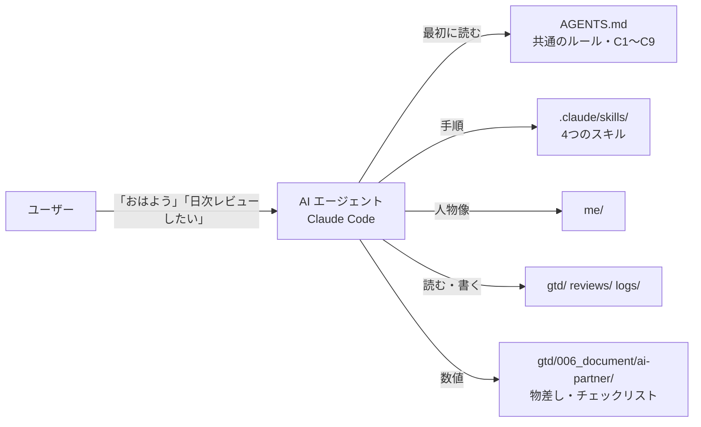

# gtd-ai-partner

GTD（Getting Things Done）で管理している Markdown のワークスペースを土台に、AI エージェント（Claude Code）に秘書 / フィジカル・トレーナー / メンターの役割を担ってもらうための、スキルとルールの一式。作り物のサンプルのワークスペース付き。

## デモ

サンプルのワークスペース（`sample-workspace/`）で、「今日は 2026-06-14（日）」として動かしたときのやり取りの抜粋。人物も出来事もすべて作り物。

### 朝の秘書（「おはようございます」）

```text
## 1. 体の調子
- 今朝の値：睡眠 7.8時間・スコア 72、HRV 43、BB最大 64、安静時心拍 55。空欄はありません
- 物差しの「ふだん（直近30日の平均）」は HRV 48.0、BB最大 61.1 です
- 「疲れが大きい朝」の目安（BB最大が 40 以下）には当たりません。予定どおり動いて大丈夫です
- 昨日ははじめて 10km を超えるジョグ（10.60km）で、レビューには「脚が少し張っている」とありました

## 4. 今日の予定
1. 15:00 ランニングショップでシューズを試し履きする
- 母の誕生日は 6/28 です。今日がちょうど声をかける日なので、プレゼントを決めて手配しましょう
- 部屋の更新の書類は 2026-06-30 が期限です

## 5. 今夜のご飯
1. 野菜炒めと、作り置きのひじき煮
2. 鍋（最後に食べたのが 06-09 で、間が空いています）
```

### 週次レビュー（「週次レビューして」）の「体」の欄

```text
- 運動: ジョグ 3回 計 22.2km（06/09 5.40km、06/11 6.20km、06/13 10.60km）。週 3回・週 20km の両方に届いた
  - 10km 超えは今週 1回（06/13）で「週1回まで」の内。3日続けて走った日はない
- ステップを上げてよさそうな種目: なし
  - 膝つき腕立てが目安の 20×3 に届いたのは 1回目（06/10）。あと 1回届けば上げてよい
  - スクワットは目安の 25×3 を 2回達成したが、ジャンプのある次のステップは大会まで出さない決まり
```

数値は、ワークスペースのログと「物差し」のファイル（`gtd/006_document/ai-partner/trainer.md`）から数え直したもの。4つのスキルを動かした結果は [`notes/issue-2-trial.md`](notes/issue-2-trial.md) にある。

## 背景・課題

作者は、todo・プロジェクト・日々の記録を Markdown と git で管理している。AI エージェントにこのフォルダを読ませれば、自分の状況をわかったうえで手伝ってもらえる。そこで、人物像や目標の要約（`me/`）と共通のルール（`AGENTS.md`）を置き、日次レビュー・朝の秘書・週次レビューを AI に頼むようにした。

使い続けるうちに、2つの課題が見えた。

- **レビューは、材料をそろえる手間で止まる**: 何をやったか、体の調子はどうか、todo に何が残っているかを集めるだけで時間がかかり、週次レビューは何か月も止まっていた。そこで、AI が材料をそろえて質問し、答えを各ファイルに書き分ける形にして、日次レビューを 10分で終えられるようにした
- **AI は毎回ゼロから考えるので、決めごととずれる**: たとえば、ジョギングの物差しに「心拍 150 以下」と書いてあるのに、AI が「140 前後」と言い換えたことがあった。役割が増えるほど、こうしたずれは増える。そこで、ずれを記録して「必ず守ること」のチェックリストにまとめ、週次レビューでずれの数を数えるようにした

このリポジトリは、その仕組みから作者の個人の情報を抜き、誰でも試せる形にしたもの。

## 主な機能

| 機能 | スキル | 役割 | やること |
| --- | --- | --- | --- |
| 日次レビュー | `daily-review` | 秘書 / トレーナー | その日の done・YWT（やったこと・わかったこと・次にやること）を書き、翌日の todo を整える。2往復で終わる |
| 朝の秘書 | `morning-brief` | 秘書 / トレーナー | 今日やることだけをまとめる（体の調子・運動・ゴミ・予定・期限と誕生日・今夜のご飯の2択） |
| 週次レビュー | `weekly-review` | メンター / トレーナー | GTD の Get Clear / Get Current / Get Creative に沿った下書きを作り、変更は提案として出す |
| Inbox の振り分け | `inbox-triage` | 秘書 | Inbox の項目を todo・プロジェクト・資料などに振り分ける。迷うものは質問として残す |
| 助言の評価 | （チェックリスト） | 全役割 | AI の助言や作業の報告が決めごとと矛盾していないかを、週次レビューで確かめる |

## アーキテクチャ・技術スタック



- **ワークスペース**: Markdown のファイルを git で管理する 1つのフォルダ。Obsidian などのアプリは要らない
- **`AGENTS.md`**: AI が最初に読む共通のルール。読み取りポリシー（機微な情報は読む前に確認する）と、助言・報告で必ず守ること（C1〜C9）
- **`me/`**: AI が「この人は誰か」を知るための要約（人物像・価値観と目標・今の状況・好み）
- **スキル**: 手順だけを書き、人ごとに違う数値（運動の目安、苦手な食べ物など）は書かない。数値は参照ファイルに置き、スキルはそれを「そのまま使う」
- **記録**: todo・done・レビューは Markdown、ログは Markdown の表、筋トレは JSON Lines（DuckDB で集計できる）
- フォルダの形は [`sample-workspace/AGENTS.md`](sample-workspace/AGENTS.md) の「ディレクトリ構成」を参照

## 技術選定理由

- 記録は Markdown と git にまとめる。特定のアプリやサービスに頼らず、AI エージェントがそのまま読めるため
- 人ごとに違う数値はスキルに書かず、参照ファイルに出す。使う人が数値を書き換えるだけで済むため（[ADR 0003](decisions/0003-sample-vault-layout.md)）
- 「Vault」（Obsidian の用語）ではなく「ワークスペース」と呼ぶ（[ADR 0004](decisions/0004-call-it-workspace.md)）
- 公開するのは作り物のサンプルだけ（[ADR 0001](decisions/0001-publish-policy.md)）。作者のワークスペースを正にして、汎用に直したものをここに写している（[ADR 0002](decisions/0002-author-vault-is-source.md)）

## セットアップ

必要なもの: [Claude Code](https://code.claude.com/docs/en/overview)、git、[ripgrep](https://github.com/BurntSushi/ripgrep)（`rg`。スキルが検索に使う）

```bash
git clone https://github.com/ksip9012/gtd-ai-partner.git
cp -R gtd-ai-partner/sample-workspace ~/my-workspace
cd ~/my-workspace
git init && git add -A && git commit -m "start"
claude
```

`.claude/skills/` にあるスキルは、Claude Code をこのフォルダで開くと自動で読み込まれる。

自分用に使うときは、次を自分の内容に書き換える。

| ファイル | 書くこと |
| --- | --- |
| `me/` の 4つ | 人物像・価値観と目標・今の状況・AI への頼み方 |
| `gtd/002_todo.md` | ルーティン（運動の曜日・ゴミの日）、カレンダー、タスク |
| `gtd/006_document/ai-partner/trainer.md` | 運動の予定と物差し（疲れの目安、回数の上限） |
| `gtd/006_document/life/meals.md`・`deadlines.md` | 定番のご飯と苦手なもの、期限と誕生日 |
| `logs/logs_YYYY.md` | 睡眠・回復の値・運動の記録（ウェアラブルの値を朝に書く） |
| `AGENTS.md` | 要確認の領域（機微な情報を置くフォルダ） |

## 使い方

Claude Code に話しかける。

| 話しかける言葉 | 動くスキル | いつ |
| --- | --- | --- |
| 「おはよう」「今日やることは？」 | `morning-brief` | 毎朝 |
| 「日次レビューしたい」「今日の振り返り」 | `daily-review` | 毎晩 |
| 「週次レビューして」 | `weekly-review` | 週に1回、朝 |
| 「inbox処理して」 | `inbox-triage` | Inbox がたまったとき |

日次レビューは、1回目の返事で質問がまとめて出る。番号ごとに短く答えると、2回目の返事で done・日次レビュー・todo に書き分けてコミットする。

## 動作確認

テストコードはない（スキルは Markdown の手順）。サンプルのワークスペースを一時フォルダに写し、画面なしの Claude Code（`claude -p`）で 4つのスキルを動かして確かめた。結果は [`notes/issue-2-trial.md`](notes/issue-2-trial.md)。

決まった形は、`mise run check` で確かめる（CI と pre-commit も同じものを動かす）。

- スキル・`AGENTS.md` などに書いたワークスペースのパスが、サンプルにあるか（`scripts/check_workspace.py`。日付入りのパターンと、例として書いたものは除く）
- 各スキルの `SKILL.md` の frontmatter に `name` と `description` があり、`name` がフォルダ名と同じか
- Markdown の書き方（markdownlint。設定は `.markdownlint-cli2.jsonc`）

```bash
mise trust && mise install
pre-commit install   # コミットの前に mise run check を動かす（任意）
mise run check
```

スキルを実際に動かしたときの中身（AI の返事が手順どおりか）は、CI では確かめていない。

## 今後の展望・既知の制約

- v0.2 以降: Garmin からのライフログの自動取得、Google カレンダーへの写し、朝のニュース、外出先からの投げ込み
- 日本語で書いたワークスペースを前提にしている
- 確かめたのは Claude Code（2.1.309）だけ。`AGENTS.md` は Codex なども読むが、スキルの形式は Claude Code のもの
- サンプルは git のコミットが 1つだけなので、週次レビューの「2週間以上動いていないもの」（`git log -S` で追加日を見る）は、ふだん使い始めてから効く
- フィジカル・トレーナーは医療の判断をしない。気になる値が続くときは受診を勧めるだけ

## ライセンス

[MIT](LICENSE)
