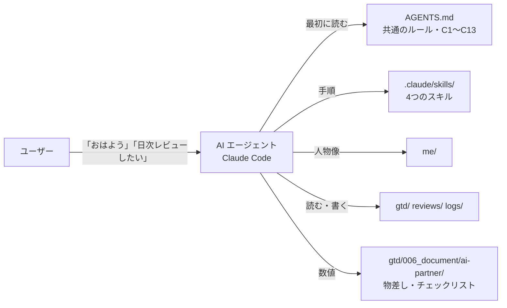

# gtd-ai-partner

[](https://github.com/ksip9012/gtd-ai-partner/actions/workflows/ci.yml)

Claude Code に「おはよう」「日次レビューしたい」と話しかけるだけで、今日の予定のまとめ・1日の振り返り・週次レビューの下書きを手伝ってもらうための仕組み。

GTD（Getting Things Done）で管理している Markdown のワークスペースを土台に、AI エージェント（Claude Code）に秘書 / フィジカル・トレーナー / メンターの役割を担ってもらう。中身は、Claude Code の手順書（スキル）と、AI が最初に読む共通のルール（`AGENTS.md`）の一式。作り物のサンプルのワークスペース付き。

> **English:** Claude Code skills and shared rules that let an AI agent act as your secretary, physical trainer, and mentor on top of a GTD workspace kept in Markdown and git. A fictional sample workspace is included. The documentation and the skills are written in Japanese.

## デモ

サンプルのワークスペース（`sample-workspace/`）で、「今日は 2026-06-14（日）」として動かしたときのやり取りの抜粋（2026-11-15 に今のスキルで動かした出力）。人物も出来事もすべて作り物。

### 朝の秘書（「おはようございます」）

```text
## 1. 体の調子
- 今朝の値（logs 6/14 の行）: 睡眠 7.8時間・スコア 72、BB最大 64、HRV 43、安静時心拍 55。空欄はありません。
- 物差しの「疲れが大きい朝」は BB最大 40 以下です。今朝は 64 なので当たりません。
- 直近30日（5/15〜6/13）の平均と比べると、BB最大は 61.1 で、今朝はそれより上です。HRV は平均 48 に対して 43 で、少し低めです。昨日 10.60km 走った翌朝なので、その影響かもしれません（推定）。

## 2. 天気と傘
- 最高 26.8℃、最低 18.4℃です。
- 外に出るのは 15:00 の試し履きの前後です。14〜16時の降水確率は 6〜9% です。
- 傘はいりません。

## 5. 今日の予定
1. 朝: 筋トレ → 週次レビュー
2. 15:00 ランニングショップでシューズを試し履きする（ハーフマラソン）。今のシューズは 600km を超えています。2足を比べて決めます。
- 母の誕生日 6/28。今日から声をかける時期です。プレゼントを選んで送る手配をしてください。
- 部屋の更新の書類の期限は 2026-06-30 です。

## 6. 今夜のご飯
- A: 野菜炒め＋作り置きのひじき煮: 照り焼きは昨日食べたので外しました。
- B: 鍋: 最後に食べたのは 6/9 で、少し間が空いています。
```

### 週次レビュー（「週次レビューして」）の「体」と「プロジェクト」の欄

```text
- 運動: ジョグ 3回 計 22.20km（06/09 5.40km、06/11 6.20km、06/13 10.60km）。物差しの「週 20km」と「週3回」に届いた
  - 10km 超えは今週 1回（06/13）で「週1回まで」に合っている。3日続けて走った日はない
- ステップを上げてよさそうな種目: なし
  - 膝つき腕立ては、目安の 20×3 にまだ 1回（06/10）。決まりは「2回」なので、次に届いたら普通の腕立てに進める
  - スクワットは 25×3 が 2回（06/01・06/08）に届いた。ただし、ジャンプのあるステップは大会まで出さない決まり

- 期限・目安との比較:
  - ハーフマラソンに出る: 順調。目安は「8月末までに 15km（土曜）」と「週 20km」。今は土曜の 10.60km（06/13）、週 22.20km
  - Go で API を作る: 目安なし。期限は「2026-12 に個人のサイトに載せる」だけで、途中の目安は書いていない
```

数値は、ワークスペースのログと「物差し」のファイル（`gtd/006_document/ai-partner/trainer.md`）から数え直したもの。天気は、過去の日の予報を取るため、このときだけ Open-Meteo の Historical Forecast API で取った（ふだんはスキルのとおり今日の予報を取る）。4つのスキルを動かした結果は [`notes/issue-25-trial.md`](notes/issue-25-trial.md)（v0.1 のときは [`notes/issue-2-trial.md`](notes/issue-2-trial.md)）にある。

## 背景・課題

作者は、todo・プロジェクト・日々の記録を Markdown と git で管理している。AI エージェントにこのフォルダを読ませれば、自分の状況をわかったうえで手伝ってもらえる。そこで、人物像や目標の要約（`me/`）と共通のルール（`AGENTS.md`）を置き、日次レビュー・朝の秘書・週次レビューを AI に頼むようにした。

使い続けるうちに、2つの課題が見えた。

- **レビューは、材料をそろえる手間で止まる**: 何をやったか、体の調子はどうか、todo に何が残っているかを集めるだけで時間がかかり、週次レビューは何か月も止まっていた。そこで、AI が材料をそろえて質問し、答えを各ファイルに書き分ける形にした（日次レビューは 10分で終えられることを目標にしている。時間は測っていない）
- **AI は毎回ゼロから考えるので、決めごととずれる**: たとえば、ジョギングの物差しに「心拍 150 以下」と書いてあるのに、AI が「140 前後」と言い換えたことがあった。役割が増えるほど、こうしたずれは増える。そこで、ずれを記録して「必ず守ること」のチェックリストにまとめ、週次レビューでずれの数を数えるようにした

このリポジトリは、その仕組みから作者の個人の情報を抜き、誰でも試せる形にしたもの。

## 使ってみて（作者の記録から。2026-11-15 時点）

- **週次レビューが続くようになった**: 作者の週次レビューは 2026-05-31 のあと止まっていた。AI が下書きを作る形にしてから、2026-10-05 の週から 6週続いている
- **ずれは減っていないが、決まりに変わっている**: 2026-10-15 から AI のずれを記録し始め、これまでに 26件になった。週ごとの数は 4件 → 3件 → 14件で、まだ減っていない（14件の週は、確かめる範囲をやりとりの中身まで広げた）。当たる項目のないずれから決まりを足していき、全役割に共通の「必ず守ること」は C1〜C9 から C1〜C13 になった

## 主な機能

| 機能 | スキル | 役割 | やること |
| --- | --- | --- | --- |
| 日次レビュー | `daily-review` | 秘書 / トレーナー | その日の done・YWT（やったこと・わかったこと・次にやること）を書き、翌日の todo を整える。2往復で終わる |
| 朝の秘書 | `morning-brief` | 秘書 / トレーナー | 今日やることだけをまとめる（体の調子・天気と傘・運動・ゴミ・予定・期限と誕生日・今夜のご飯の2択） |
| 週次レビュー | `weekly-review` | メンター / トレーナー | GTD の Get Clear / Get Current / Get Creative に沿った下書きを作り、変更は提案として出す。プロジェクトごとに、期限・目安と比べて遅れていないかも見る |
| Inbox の振り分け | `inbox-triage` | 秘書 | Inbox の項目を todo・プロジェクト・資料などに振り分ける。迷うものは質問として残す |
| 助言の評価 | （チェックリスト） | 全役割 | AI の助言や作業の報告が決めごとと矛盾していないかを、週次レビューで確かめる |

## アーキテクチャ・技術スタック



- **ワークスペース**: Markdown のファイルを git で管理する 1つのフォルダ。Obsidian などのアプリは要らない
- **`AGENTS.md`**: AI が最初に読む共通のルール。読み取りポリシー（機微な情報は読む前に確認する）と、助言・報告で必ず守ること（C1〜C13）
- **`me/`**: AI が「この人は誰か」を知るための要約（人物像・価値観と目標・今の状況・好み）
- **スキル**: 手順だけを書き、人ごとに違う数値（運動の目安、苦手な食べ物など）は書かない。数値は参照ファイルに置き、スキルはそれを「そのまま使う」
- **記録**: todo・done・レビューは Markdown、ログは Markdown の表、筋トレは JSON Lines（DuckDB で集計できる）
- フォルダの形は [`sample-workspace/AGENTS.md`](sample-workspace/AGENTS.md) の「ディレクトリ構成」を参照

## 技術選定理由

- 記録は Markdown と git にまとめる。特定のアプリやサービスに頼らず、AI エージェントがそのまま読めるため
- 人ごとに違う数値はスキルに書かず、参照ファイルに出す。使う人が数値を書き換えるだけで済むため（[ADR 0003](decisions/0003-sample-vault-layout.md)）
- 「Vault」（Obsidian の用語）ではなく「ワークスペース」と呼ぶ（[ADR 0004](decisions/0004-call-it-workspace.md)）
- 公開するのは作り物のサンプルだけ（[ADR 0001](decisions/0001-publish-policy.md)）。作者のワークスペースを正にして、汎用に直したものをここに写している（[ADR 0002](decisions/0002-author-vault-is-source.md)）

## セットアップ

必要なもの: [Claude Code](https://code.claude.com/docs/en/overview)、git、[ripgrep](https://github.com/BurntSushi/ripgrep)（`rg`。スキルが検索に使う）

```bash
git clone https://github.com/ksip9012/gtd-ai-partner.git
cp -R gtd-ai-partner/sample-workspace ~/my-workspace
cd ~/my-workspace
git init && git add -A && git commit -m "start"
claude
```

`.claude/skills/` にあるスキルは、Claude Code をこのフォルダで開くと自動で読み込まれる。

自分用に使うときは、次を自分の内容に書き換える。

| ファイル | 書くこと |
| --- | --- |
| `me/` の 4つ | 人物像・価値観と目標・今の状況・AI への頼み方 |
| `gtd/002_todo.md` | ルーティン（運動の曜日・ゴミの日）、カレンダー、タスク |
| `gtd/006_document/ai-partner/trainer.md` | 運動の予定と物差し（疲れの目安、回数の上限） |
| `gtd/006_document/life/meals.md`・`deadlines.md` | 定番のご飯と苦手なもの、期限と誕生日 |
| `logs/logs_YYYY.md` | 睡眠・回復の値・運動の記録（ウェアラブルの値を朝に書く） |
| `AGENTS.md` | 要確認の領域（機微な情報を置くフォルダ） |

## 使い方

Claude Code に話しかける。

| 話しかける言葉 | 動くスキル | いつ |
| --- | --- | --- |
| 「おはよう」「今日やることは？」 | `morning-brief` | 毎朝 |
| 「日次レビューしたい」「今日の振り返り」 | `daily-review` | 毎晩 |
| 「週次レビューして」 | `weekly-review` | 週に1回、朝 |
| 「inbox処理して」 | `inbox-triage` | Inbox がたまったとき |

日次レビューは、1回目の返事で質問がまとめて出る。番号ごとに短く答えると、2回目の返事で done・日次レビュー・todo に書き分けてコミットする。

## 動作確認

テストコードはない（スキルは Markdown の手順）。サンプルのワークスペースを一時フォルダに写し、画面なしの Claude Code（`claude -p`）で 4つのスキルを動かして確かめた。結果は [`notes/issue-2-trial.md`](notes/issue-2-trial.md)。

決まった形は、`mise run check` で確かめる（CI と pre-commit も同じものを動かす）。

- スキル・`AGENTS.md` などに書いたワークスペースのパスが、サンプルにあるか（`scripts/check_workspace.py`。日付入りのパターンと、例として書いたものは除く）
- 各スキルの `SKILL.md` の frontmatter に `name` と `description` があり、`name` がフォルダ名と同じか
- Markdown の書き方（markdownlint。設定は `.markdownlint-cli2.jsonc`）

```bash
mise trust && mise install
pre-commit install   # コミットの前に mise run check を動かす（任意）
mise run check
```

スキルを実際に動かしたときの中身（AI の返事が手順どおりか）は、CI では確かめていない。

### 作者が写すときの確認

ここからは、作者が自分のワークスペースからサンプルに写すときの確認。サンプルを試すだけなら要らない。

足した行に個人の情報の語がないかは、`mise run check-private` で確かめる（`scripts/check_private_words.py`。CI も同じものを動かす）。語のリストはリポジトリの外に置き、一致したときもファイル名と行番号だけを出す（[ADR 0005](decisions/0005-private-words-check.md)）。

```bash
# 1行 1語。手元のファイルを正にして、同じ中身を CI の Secrets にも入れる
mkdir -p ~/.config/gtd-ai-partner
$EDITOR ~/.config/gtd-ai-partner/private-words.txt
gh secret set PRIVATE_WORDS < ~/.config/gtd-ai-partner/private-words.txt
mise run check-private
```

## 今後の展望・既知の制約

- v0.2 以降: Garmin からのライフログの自動取得、Google カレンダーへの写し、朝のニュース、外出先からの投げ込み
- 日本語で書いたワークスペースを前提にしている
- 確かめたのは Claude Code（2.1.309 と 2.1.311）だけ。`AGENTS.md` は Codex なども読むが、スキルの形式は Claude Code のもの
- CI（`mise run check`）が確かめるのは決まった形（スキルが指すパス・`SKILL.md` の frontmatter・Markdown の書き方）だけ。スキルを動かしたときの中身は見ていない
- 作者のワークスペースのスキルを正にして、個人の情報を外して写している（[ADR 0002](decisions/0002-author-vault-is-source.md)）。足した行に個人の情報の語がないかは CI でも確かめるが、見つけられるのは語のリストに書いた語だけ（[ADR 0005](decisions/0005-private-words-check.md)）
- サンプルは git のコミットが 1つだけなので、週次レビューの「2週間以上動いていないもの」（`git log -S` で追加日を見る）は、ふだん使い始めてから効く
- フィジカル・トレーナーは医療の判断をしない。気になる値が続くときは受診を勧めるだけ

## ライセンス

[MIT](LICENSE)
